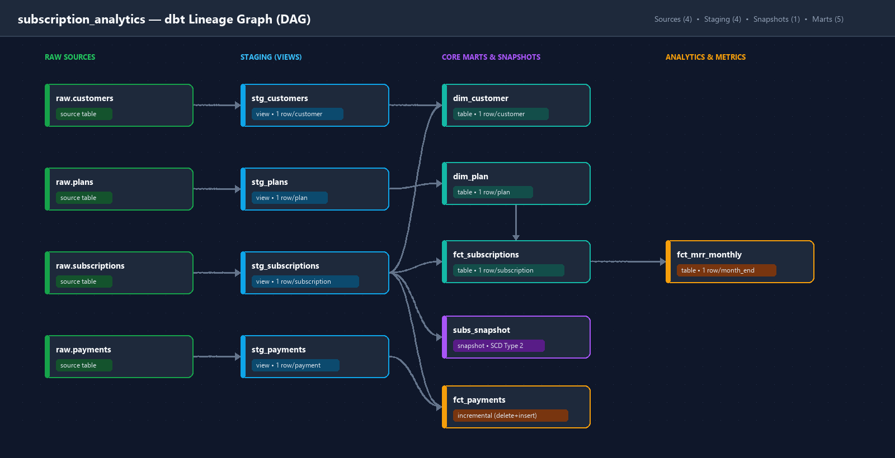

# Subscription Analytics (dbt + DuckDB)

[](https://github.com/aleks-al-aleksandrov/subscription-analytics-dbt/actions/workflows/dbt.yml)

## Purpose

I built this project to practise analytics engineering end to end on a realistic problem: a subscription business with customers, plans, subscriptions and payments. The goal is to go from messy raw data to clean, tested models that can answer questions like "what is our MRR?", "how many subscriptions changed plans or churned?", and "do our billed payments reconcile with our staging layer?".

## Architecture & Lineage



```text
scripts/generate_data.py      synthetic CSVs  ->  data/raw/*.csv
scripts/load_raw.py           CSVs            ->  DuckDB schema "raw"

raw (tables)
  customers, plans, subscriptions, payments
        |
        v
staging (views)               models/staging
  stg_customers, stg_plans, stg_subscriptions, stg_payments
        |
        +---> snapshots (SCD Type 2)     snapshots/subs_snapshot.sql
        |
        v
marts (tables & incremental)  models/marts
  dim_customer, dim_plan, fct_subscriptions, fct_payments (incremental), fct_mrr_monthly
```

I keep the layers strict:

- **raw** is an untouched copy of the source CSVs loaded into the `raw` schema.
- **staging** (`models/staging/`) has one view per source table. This is where I rename, cast, trim, standardize casing, and deduplicate. No joins happen here.
- **snapshots** (`snapshots/subs_snapshot.sql`) captures SCD Type 2 history (`dbt_valid_from`, `dbt_valid_to`) on top of `stg_subscriptions` across multiple loads.
- **marts** (`models/marts/`) joins staging models into dimensions, facts, and monthly metrics, each with a documented grain and schema tests.

### Model Catalog & Grain

| Model / Resource | Layer | Materialization | Grain | Primary Key |
| :--- | :--- | :--- | :--- | :--- |
| `stg_customers` | Staging | View | One row per deduplicated customer | `customer_id` |
| `stg_plans` | Staging | View | One row per subscription plan | `plan_id` |
| `stg_subscriptions` | Staging | View | One row per subscription (current state) | `subscription_id` |
| `stg_payments` | Staging | View | One row per deduplicated payment | `payment_id` |
| `subs_snapshot` | Snapshots | Snapshot (SCD2) | One row per subscription version (`subscription_id` + `dbt_valid_from`) | `dbt_scd_id` |
| `dim_customer` | Marts | Table | One row per customer (with `is_active_customer`) | `customer_id` |
| `dim_plan` | Marts | Table | One row per plan (with normalized `monthly_price_eur`) | `plan_id` |
| `fct_subscriptions` | Marts | Table | One row per subscription (with `monthly_value_eur` and `tenure_days`) | `subscription_id` |
| `fct_payments` | Marts | Incremental (`delete+insert`) | One row per payment transaction | `payment_id` |
| `fct_mrr_monthly` | Marts | Table | One row per calendar month (`month_end_date`) | `month_end_date` |

## Data

There is no real company behind this, so the project uses a synthetic data generator (`scripts/generate_data.py`). It uses a fixed seed (`42`), so the output is deterministic on every run. The `--as-of` flag controls what the source system looks like on a given day. Loading first with `2026-06-30` and then with `2026-09-30` simulates two point-in-time extracts with new customers, recurring payments, plan upgrades/downgrades, and cancellations.

The generator includes realistic data quality issues for the staging layer and tests to handle:

- duplicate customer rows (`~1%` with a later `updated_at`) and exact duplicate payment rows (`~1%`)
- emails in mixed case, plus `~2%` empty strings
- country codes in lowercase or padded with extra whitespace
- around `2%` of payments arriving 3–6 days after their `payment_date` (`created_at > payment_date`)

## How to run from scratch

You need Python 3.13. The commands below are for Windows PowerShell.

```powershell
git clone https://github.com/aleks-al-aleksandrov/subscription-analytics-dbt.git
cd subscription-analytics-dbt
python -m venv .venv
.venv\Scripts\Activate.ps1
pip install dbt-core dbt-duckdb

# Batch 1: Initial load as of 2026-06-30
python scripts\generate_data.py --as-of 2026-06-30
python scripts\load_raw.py

cd subscription_analytics
dbt debug --profiles-dir .
dbt build --profiles-dir .
cd ..

# Batch 2: Second load as of 2026-09-30 (triggers incremental load + SCD2 snapshot history)
python scripts\generate_data.py --as-of 2026-09-30
python scripts\load_raw.py

cd subscription_analytics
dbt build --profiles-dir .
dbt docs generate --profiles-dir .
dbt docs serve --profiles-dir .
```

`profiles.yml` is inside `subscription_analytics/` and points to the local database file `subscription_analytics/subscription.duckdb`.

## Architectural Decisions & Trade-offs

- **DuckDB instead of a cloud warehouse.** It runs locally in-process, requires zero cloud credentials, runs in GitHub Actions CI out of the box, and supports full SQL DML (`DELETE`, `INSERT`, `MERGE`) required by incremental models and SCD Type 2 snapshots.
- **Staging as views, marts as tables.** Staging views cost almost nothing to create and always reflect the latest `raw` tables. Marts are queried repeatedly by downstream consumers and BI tools, so materializing them as tables (and incremental tables for high-volume transactions) keeps query latency low.
- **Deduplication in staging.** For `stg_customers`, I partition by `customer_id` and keep the latest row by `updated_at desc`. For `stg_payments`, I partition by `payment_id` and keep the latest row by `created_at desc`.
- **Flags instead of hard row filters.** Staging adds `is_late_arrival` and `is_successful` boolean flags on `stg_payments` and `is_active` on `stg_subscriptions` instead of filtering out failed or canceled records. Downstream models can filter when needed while keeping failed payments available for payment-failure analysis.

## Incremental Loading (`fct_payments`)

`fct_payments` is configured as an incremental model (`materialized='incremental'`, `unique_key='payment_id'`, `incremental_strategy='delete+insert'`).

```sql

where payment_date >= (
    select max(payment_date) - interval '7 days'
    from {{ this }}
)

```

### How it runs

1. **Initial run (or `dbt run --select fct_payments --full-refresh`)**: `is_incremental()` evaluates to `false`, so dbt builds `main.fct_payments` from the entire `stg_payments` view (`14,111` rows for `--as-of 2026-06-30`).
2. **Subsequent incremental runs (`dbt run --select fct_payments`)**: `is_incremental()` evaluates to `true`. dbt selects only rows from `stg_payments` with `payment_date >= max(payment_date) - interval '7 days'`, stages them in a temporary table, deletes matching `payment_id` rows from `main.fct_payments`, and inserts the staged rows (`18,864` total rows after `--as-of 2026-09-30`).

### Why a 7-day lookback window?

In the source data, around 2% of payments arrive 3–6 days after their `payment_date` (`created_at > payment_date`). Filtering strictly on `payment_date > max(payment_date)` would miss transactions whose `payment_date` falls before the high-water mark but landed in the source system days later. A 7-day lookback window covers the 3–6 day arrival lag while keeping incremental scans small. Because `unique_key='payment_id'` is set, re-reading the last 7 days overwrites existing rows cleanly without creating duplicates.

### Why `delete+insert` instead of `merge`?

- **Adapter behavior & simplicity**: In DuckDB, `delete+insert` stages the incoming slice in a temporary table, deletes matching `payment_id` rows from the target table in a single vectorized pass, and inserts the staged rows.
- **Trade-offs & risks**:
  - `delete+insert` replaces the entire row for matched keys, which is ideal here because we want the latest state of every column in the lookback window.
  - On cloud warehouses with large partitioned/clustered tables, `merge` can sometimes avoid rewriting unchanged columns, whereas `delete+insert` marks deleted rows and appends new micro-partitions.
  - If a payment arrived more than 7 days late, the lookback window would miss it; a periodic `--full-refresh` (or filtering on an ingestion watermark with a lookback) would be needed to catch extreme outliers.

## Snapshots & SCD Type 2 History (`subs_snapshot`)

Source subscription records are overwritten in place whenever a customer upgrades/downgrades their plan or cancels. Querying `stg_subscriptions` alone only shows the **current** `plan_id` and `status` as of the latest load, losing the historical state needed to audit plan transitions or point-in-time subscription attributes.

To preserve history, `snapshots/subs_snapshot.sql` implements an **SCD Type 2** snapshot on top of `stg_subscriptions` (`unique_key='subscription_id'`, `strategy='timestamp'`, `updated_at='updated_at'`).

### Validating historical versions in `snapshots.subs_snapshot`

After running the `2026-06-30` load followed by the `2026-09-30` load:
- `stg_subscriptions` has `2,000` rows (one current row per subscription).
- `snapshots.subs_snapshot` has `2,084` rows across those `2,000` subscriptions: `84` subscriptions that changed plans or canceled between `2026-06-30` and `2026-09-30` have two rows—a closed historical version (`dbt_valid_to IS NOT NULL`) and an open current version (`dbt_valid_to IS NULL`).

Example rows from `snapshots.subs_snapshot`:

| `subscription_id` | `plan_id` | `status` | `dbt_valid_from` | `dbt_valid_to` | Change captured |
| :--- | :--- | :--- | :--- | :--- | :--- |
| `sub_00091` | `basic_m` | `active` | `2025-10-30 00:00:00` | `2026-08-23 00:00:00` | Historical active state |
| `sub_00091` | `basic_m` | `canceled` | `2026-08-23 00:00:00` | `NULL` | Canceled on `2026-08-23` |
| `sub_00095` | `standard_m` | `active` | `2026-03-06 00:00:00` | `2026-09-29 00:00:00` | Initial `standard_m` plan |
| `sub_00095` | `basic_m` | `active` | `2026-09-29 00:00:00` | `NULL` | Downgraded to `basic_m` on `2026-09-29` |

## Metrics (`fct_mrr_monthly`)

`fct_mrr_monthly` summarizes Monthly Recurring Revenue at a calendar-month grain (`month_end_date` is the primary key).

### MRR Definition

- **Active at month-end**: A subscription is counted as active in a given month if `started_date <= month_end_date` and `(canceled_date is null or canceled_date > month_end_date)`.
- **Normalized monthly recurring value (`monthly_value_eur`)**:
  - Monthly plans contribute their full `price_eur` (`9.00`, `19.00`, or `39.00` EUR).
  - Annual plans (`standard_a` at `190.00` EUR/year) are normalized to `round(price_eur / 12.0, 2)` (`15.83` EUR/month).
- **`mrr_eur`**: The sum of `monthly_value_eur` across all subscriptions active as of `month_end_date` (`30,009.16` EUR as of `2026-09-30` across `1,735` active subscriptions).
- **`arr_eur`**: `mrr_eur * 12` (`360,109.92` EUR as of `2026-09-30`).
- **Month spine**: Generated dynamically from `min(started_date)` through `max(updated_at)` so every month in the dataset range is represented.

## Data Quality & Test Coverage

The project runs **84 data tests** (`94` total build steps including models and snapshot) across generic schema assertions and custom singular SQL tests:

### What is covered by tests

1. **Primary key integrity (`unique`, `not_null`)**: Every staging model, mart model, and snapshot tests its key (`customer_id`, `plan_id`, `subscription_id`, `payment_id`, `month_end_date`, `dbt_scd_id`).
2. **Referential integrity (`relationships`)**: Foreign keys in `stg_subscriptions`, `stg_payments`, `fct_subscriptions`, and `fct_payments` are verified against their parent tables.
3. **Domain constraints (`accepted_values`)**: Validated on `country`, `segment`, `billing_period`, `currency`, subscription `status`, and payment `status`.
4. **Business logic singular tests (`tests/`)**:
   - `assert_cancel_after_start.sql`: Ensures no subscription has `canceled_date < started_date`.
   - `assert_payment_amount_positive.sql`: Ensures all payment amounts are strictly positive (`amount_eur > 0`).
   - `assert_no_conflicting_raw_duplicates.sql`: Checks `raw.payments` and `raw.customers` to ensure duplicate primary keys never contain conflicting cleaned business attributes (preventing `row_number()` deduplication from silently hiding data corruption).
   - `assert_payment_reconciliation.sql`: Financial reconciliation test ensuring the count and total `amount_eur` of successful payments (`is_successful = true`) in `fct_payments` match `stg_payments` to the cent.
   - `assert_mrr_sanity.sql`: Ensures monthly MRR and active subscription counts are strictly positive and non-null for every calendar month in `fct_mrr_monthly`, preventing an empty or unloaded month from silently displaying as `0.00` EUR MRR.

### What remains uncovered

- **Source freshness / SLA checks**: Because the data is generated locally from CSVs rather than streamed from a live production database, `dbt source freshness` is not configured.
- **Late arrivals beyond the 7-day lookback window**: If a payment arrives more than 7 days after its `payment_date` and after the high-water mark has advanced, an incremental run of `fct_payments` would not pick it up until `assert_payment_reconciliation.sql` flags the discrepancy or a `--full-refresh` is run.
- **Historical MRR plan transitions**: `fct_mrr_monthly` joins against `fct_subscriptions` (current plan) rather than `snapshots.subs_snapshot`, so past months reflect the subscription's current plan rather than the historical plan prior to an upgrade/downgrade.

## Project Constraints & Known Limitations

- **Synthetic dataset**: The dataset is generated via `scripts/generate_data.py` (fixed seed `42`), so it only reflects the patterns and edge cases programmed into the script.
- **DuckDB selected due to BigQuery sandbox DML limitations**: I originally explored BigQuery, but the free BigQuery sandbox blocks DML statements (`MERGE`, `UPDATE`, `DELETE`, `INSERT`) required for incremental models and SCD Type 2 snapshots. DuckDB runs the exact same dbt materializations locally with zero cost.
- **Snapshot cadence**: `subs_snapshot` records state changes between runs of `dbt snapshot`; if a subscription changed plans twice between two snapshot runs, only the state present at snapshot execution time is recorded.
