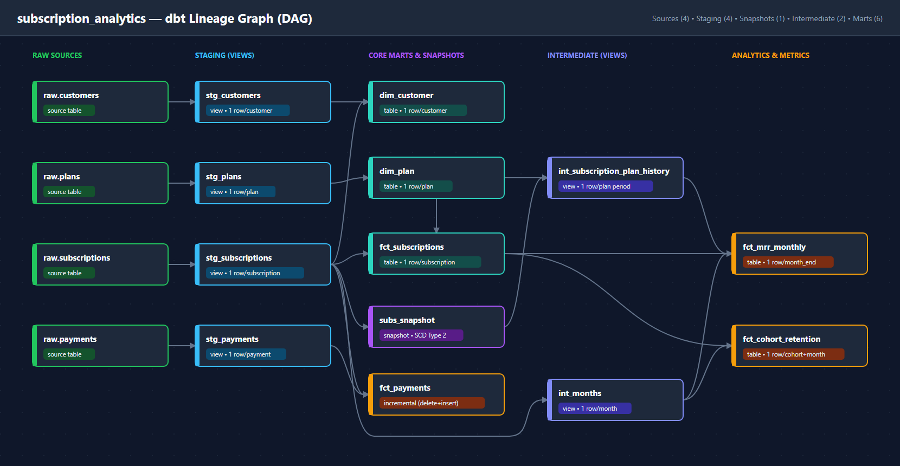
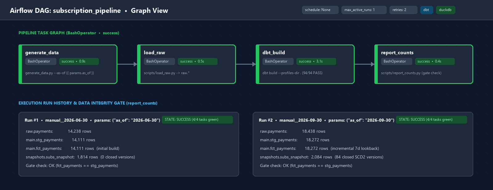

# Subscription Analytics (dbt + DuckDB)

[](https://github.com/aleks-al-aleksandrov/subscription-analytics-dbt/actions/workflows/dbt.yml)


> **An end-to-end analytics engineering project**: staging views, dimensional marts, incremental payments with an ingestion-time watermark, SCD Type 2 subscription snapshots, MRR, churn and cohort retention metrics, 103 schema & custom financial tests plus 6 unit tests, source freshness checks, and containerized Airflow orchestration.

---

## Quick Navigation

- [Purpose](#purpose)
- [Architecture & Lineage](#architecture---lineage)
- [Model Catalog & Grain](#model-catalog---grain)
- [Synthetic Data Generation](#data)
- [How to Run From Scratch](#how-to-run-from-scratch)
- [Architectural Decisions & Trade-offs](#architectural-decisions---trade-offs)
- [Incremental Loading (fct_payments)](#incremental-loading-fct_payments)
- [Snapshots & SCD Type 2 History (subs_snapshot)](#snapshots---scd-type-2-history-subs_snapshot)
- [Metrics (fct_mrr_monthly, fct_cohort_retention)](#metrics-fct_mrr_monthly-fct_cohort_retention)
- [Data Quality & Test Coverage](#data-quality---test-coverage)
- [Orchestration with Airflow](#orchestration-with-airflow)
- [Project Constraints & Known Limitations](#project-constraints---known-limitations)

---

## Purpose

I built this project to practise analytics engineering end to end on a realistic problem: a subscription business with customers, plans, subscriptions and payments. The goal is to go from messy raw data to clean, tested models that can answer questions like "what is our MRR?", "how many subscriptions changed plans or churned?", and "do our billed payments reconcile with our staging layer?".

## Architecture & Lineage



```text
scripts/generate_data.py      synthetic CSVs  ->  data/raw/*.csv
scripts/load_raw.py           CSVs            ->  DuckDB schema "raw"

raw (tables)
  customers, plans, subscriptions, payments
        |
        v
staging (views)               models/staging
  stg_customers, stg_plans, stg_subscriptions, stg_payments
        |
        +---> snapshots (SCD Type 2)     snapshots/subs_snapshot.sql
        |
        v
intermediate (views)          models/intermediate
  int_months, int_subscription_plan_history
        |
        v
marts (tables & incremental)  models/marts
  dim_customer, dim_plan, fct_subscriptions, fct_payments (incremental),
  fct_mrr_monthly, fct_cohort_retention
```

I keep the layers strict:

- **raw** is an untouched copy of the source CSVs loaded into the `raw` schema.
- **staging** (`models/staging/`) has one view per source table. This is where I rename, cast, trim, standardize casing, and deduplicate. No joins happen here.
- **snapshots** (`snapshots/subs_snapshot.sql`) captures SCD Type 2 history (`dbt_valid_from`, `dbt_valid_to`) on top of `stg_subscriptions` across multiple loads.
- **intermediate** (`models/intermediate/`) holds building blocks shared by several marts: the calendar month spine and the plan history of each subscription derived from the snapshot.
- **marts** (`models/marts/`) joins staging models into dimensions, facts, and monthly metrics, each with a documented grain and schema tests.

### Model Catalog & Grain

| Model / Resource | Layer | Materialization | Grain | Primary Key |
| :--- | :--- | :--- | :--- | :--- |
| `stg_customers` | Staging | View | One row per deduplicated customer | `customer_id` |
| `stg_plans` | Staging | View | One row per subscription plan | `plan_id` |
| `stg_subscriptions` | Staging | View | One row per subscription (current state) | `subscription_id` |
| `stg_payments` | Staging | View | One row per deduplicated payment | `payment_id` |
| `subs_snapshot` | Snapshots | Snapshot (SCD2) | One row per subscription version (`subscription_id` + `dbt_valid_from`) | `dbt_scd_id` |
| `dim_customer` | Marts | Table | One row per customer (with `is_active_customer`) | `customer_id` |
| `dim_plan` | Marts | Table | One row per plan (with normalized `monthly_price_eur`) | `plan_id` |
| `fct_subscriptions` | Marts | Table | One row per subscription (with `monthly_value_eur` and `tenure_days`) | `subscription_id` |
| `fct_payments` | Marts | Incremental (`delete+insert`) | One row per payment transaction | `payment_id` |
| `int_months` | Intermediate | View | One row per calendar month in the dataset | `month_start_date` |
| `int_subscription_plan_history` | Intermediate | View | One row per subscription and plan validity period | `subscription_id` + `valid_from_date` |
| `fct_mrr_monthly` | Marts | Table | One row per calendar month (`month_end_date`) | `month_end_date` |
| `fct_cohort_retention` | Marts | Table | One row per start-month cohort and months since start | `cohort_month` + `months_since_start` |

## Data

There is no real company behind this, so the project uses a synthetic data generator (`scripts/generate_data.py`). It uses a fixed seed (`42`), so the output is deterministic on every run. The `--as-of` flag controls what the source system looks like on a given day. Loading first with `2026-06-30` and then with `2026-09-30` simulates two point-in-time extracts with new customers, recurring payments, plan upgrades/downgrades, and cancellations.

The generator includes realistic data quality issues for the staging layer and tests to handle:

- duplicate customer rows (`~1%` with a later `updated_at`) and exact duplicate payment rows (`~1%`)
- emails in mixed case, plus `~2%` empty strings
- country codes in lowercase or padded with extra whitespace
- around `2%` of payments arriving 3–6 days after their `payment_date` (`created_at > payment_date`)

## How to run from scratch

You need Python 3.13. The commands below are for Windows PowerShell.

```powershell
git clone https://github.com/aleks-al-aleksandrov/subscription-analytics-dbt.git
cd subscription-analytics-dbt
python -m venv .venv
.venv\Scripts\Activate.ps1
pip install -r requirements.txt

# Batch 1: Initial load as of 2026-06-30
python scripts\generate_data.py --as-of 2026-06-30
python scripts\load_raw.py

cd subscription_analytics
dbt debug --profiles-dir .
dbt build --profiles-dir .
cd ..

# Batch 2: Second load as of 2026-09-30 (triggers incremental load + SCD2 snapshot history)
python scripts\generate_data.py --as-of 2026-09-30
python scripts\load_raw.py

cd subscription_analytics
dbt build --profiles-dir .
dbt docs generate --profiles-dir .
dbt docs serve --profiles-dir .
```

`profiles.yml` is inside `subscription_analytics/` and points to the local database file `subscription_analytics/subscription.duckdb`.

## Architectural Decisions & Trade-offs

- **DuckDB instead of a cloud warehouse.** It runs locally in-process, requires zero cloud credentials, runs in GitHub Actions CI out of the box, and supports full SQL DML (`DELETE`, `INSERT`, `MERGE`) required by incremental models and SCD Type 2 snapshots.
- **Staging as views, marts as tables.** Staging views cost almost nothing to create and always reflect the latest `raw` tables. Marts are queried repeatedly by downstream consumers and BI tools, so materializing them as tables (and incremental tables for high-volume transactions) keeps query latency low.
- **Deduplication in staging.** For `stg_customers`, I partition by `customer_id` and keep the latest row by `updated_at desc`. For `stg_payments`, I partition by `payment_id` and keep the latest row by `created_at desc`.
- **Flags instead of hard row filters.** Staging adds `is_late_arrival` and `is_successful` boolean flags on `stg_payments` and `is_active` on `stg_subscriptions` instead of filtering out failed or canceled records. Downstream models can filter when needed while keeping failed payments available for payment-failure analysis.

## Incremental Loading (`fct_payments`)

`fct_payments` is configured as an incremental model (`materialized='incremental'`, `unique_key='payment_id'`, `incremental_strategy='delete+insert'`).

```sql

watermark as (
    select max(created_at) - interval '7 days' as reload_from
    from {{ this }}
),

...

cross join watermark
where payments.created_at >= watermark.reload_from
   or subscriptions.updated_at >= watermark.reload_from

```

### How it runs

1. **Initial run (or `dbt run --select fct_payments --full-refresh`)**: `is_incremental()` evaluates to `false`, so dbt builds `main.fct_payments` from the entire `stg_payments` view (`14,111` rows for `--as-of 2026-06-30`).
2. **Subsequent incremental runs (`dbt run --select fct_payments`)**: `is_incremental()` evaluates to `true`. dbt selects only the rows from `stg_payments` that landed since the last run (`created_at >= max(created_at) - interval '7 days'`) or that belong to a subscription changed since then (`updated_at` on `stg_subscriptions`), stages them in a temporary table, deletes matching `payment_id` rows from `main.fct_payments`, and inserts the staged rows (`18,272` total rows after `--as-of 2026-09-30`).

### Why filter on `created_at` and not `payment_date`?

In the source data, around 2% of payments arrive 3–6 days after their `payment_date` (`created_at > payment_date`). The first version of this model filtered on `payment_date >= max(payment_date) - 7 days`. That covers a 3–6 day lag, but a payment arriving more than 7 days late would be skipped silently. `created_at` is the time the row landed in the source system, so a late row always has a `created_at` above the previous high-water mark, whatever its `payment_date` is. The 7-day lookback stays as a safety margin for rows committed out of order. Because `unique_key='payment_id'` is set, re-reading those days overwrites existing rows without creating duplicates.

### Why reload payments of changed subscriptions?

`current_plan_id` comes from a join to `stg_subscriptions`. With a filter on payments alone, old payment rows kept the plan the subscription had when they were first loaded: after the `2026-09-30` batch, `153` payments on `36` subscriptions still pointed at the previous plan. The second condition (`subscriptions.updated_at >= watermark.reload_from`) reloads every payment of a subscription that changed, and `assert_payment_plan_is_current.sql` fails the build if the column ever drifts again.

### Why `delete+insert` instead of `merge`?

- **Adapter behavior & simplicity**: In DuckDB, `delete+insert` stages the incoming slice in a temporary table, deletes matching `payment_id` rows from the target table in a single vectorized pass, and inserts the staged rows.
- **Trade-offs & risks**:
  - `delete+insert` replaces the entire row for matched keys, which is ideal here because we want the latest state of every column in the lookback window.
  - On cloud warehouses with large partitioned/clustered tables, `merge` can sometimes avoid rewriting unchanged columns, whereas `delete+insert` marks deleted rows and appends new micro-partitions.
  - Reloading all payments of a changed subscription rewrites more rows than strictly needed. That is cheap at this volume; on a large fact table I would keep the plan out of the fact and join the dimension at query time instead.

## Snapshots & SCD Type 2 History (`subs_snapshot`)

Source subscription records are overwritten in place whenever a customer upgrades/downgrades their plan or cancels. Querying `stg_subscriptions` alone only shows the **current** `plan_id` and `status` as of the latest load, losing the historical state needed to audit plan transitions or point-in-time subscription attributes.

To preserve history, `snapshots/subs_snapshot.sql` implements an **SCD Type 2** snapshot on top of `stg_subscriptions` (`unique_key='subscription_id'`, `strategy='timestamp'`, `updated_at='updated_at'`).

### Validating historical versions in `snapshots.subs_snapshot`

After running the `2026-06-30` load followed by the `2026-09-30` load:
- `stg_subscriptions` has `2,000` rows (one current row per subscription).
- `snapshots.subs_snapshot` has `2,084` rows across those `2,000` subscriptions: `84` subscriptions that changed plans or canceled between `2026-06-30` and `2026-09-30` have two rows—a closed historical version (`dbt_valid_to IS NOT NULL`) and an open current version (`dbt_valid_to IS NULL`).

Example rows from `snapshots.subs_snapshot`:

| `subscription_id` | `plan_id` | `status` | `dbt_valid_from` | `dbt_valid_to` | Change captured |
| :--- | :--- | :--- | :--- | :--- | :--- |
| `sub_00091` | `basic_m` | `active` | `2025-10-30 00:00:00` | `2026-08-23 00:00:00` | Historical active state |
| `sub_00091` | `basic_m` | `canceled` | `2026-08-23 00:00:00` | `NULL` | Canceled on `2026-08-23` |
| `sub_00095` | `standard_m` | `active` | `2026-03-06 00:00:00` | `2026-09-29 00:00:00` | Initial `standard_m` plan |
| `sub_00095` | `basic_m` | `active` | `2026-09-29 00:00:00` | `NULL` | Downgraded to `basic_m` on `2026-09-29` |

## Metrics (`fct_mrr_monthly`, `fct_cohort_retention`)

`fct_mrr_monthly` summarizes Monthly Recurring Revenue at a calendar-month grain (`month_end_date` is the primary key).

### MRR Definition

- **Active at month-end**: A subscription is counted as active in a given month if `started_date <= month_end_date` and `(canceled_date is null or canceled_date > month_end_date)`.
- **Normalized monthly recurring value (`monthly_value_eur`)**:
  - Monthly plans contribute their full `price_eur` (`9.00`, `19.00`, or `39.00` EUR).
  - Annual plans (`standard_a` at `190.00` EUR/year) are normalized to `round(price_eur / 12.0, 2)` (`15.83` EUR/month).
- **Plan at month-end**: Each active subscription is priced at the plan it was on at `month_end_date`, taken from `int_subscription_plan_history` (built on `subs_snapshot`), not at its current plan. A subscription that downgraded in September still counts at its old price in August: August 2026 MRR is `29,820.67` EUR with historical plans, against `29,830.67` EUR if every subscription were priced at its current plan.
- **`mrr_eur`**: The sum of `monthly_value_eur` across all subscriptions active as of `month_end_date` (`30,009.16` EUR as of `2026-09-30` across `1,735` active subscriptions).
- **`arr_eur`**: `mrr_eur * 12` (`360,109.92` EUR as of `2026-09-30`).
- **`subscription_churn_rate`**: `churned_subscriptions` in the month divided by `active_subscriptions` at the end of the previous month (`17 / 1,723 = 0.0099` for September 2026). It is null for the first month, which has no previous month.
- **Month spine**: `int_months` is generated dynamically from `min(started_date)` through `max(updated_at)` so every month in the dataset range is represented.

### Cohort retention (`fct_cohort_retention`)

Subscriptions are grouped by the month they started (`cohort_month`). For every later month the model counts how many of them are still active at month-end (`retained_subscriptions`) and divides by `cohort_size` to get `retention_rate`. Example, the June 2025 cohort of `99` subscriptions:

| `months_since_start` | `retained_subscriptions` | `retention_rate` |
| :--- | :--- | :--- |
| `0` | `99` | `1.0000` |
| `3` | `97` | `0.9798` |
| `6` | `95` | `0.9596` |
| `12` | `86` | `0.8687` |
| `15` | `84` | `0.8485` |

## Data Quality & Test Coverage

The project runs **103 data tests** and **6 unit tests** (`122` total build steps including models and snapshot) across generic schema assertions, custom singular SQL tests and unit tests on fixed input rows:

### What is covered by tests

1. **Primary key integrity (`unique`, `not_null`)**: Every staging model, mart model, and snapshot tests its key (`customer_id`, `plan_id`, `subscription_id`, `payment_id`, `month_end_date`, `dbt_scd_id`).
2. **Referential integrity (`relationships`)**: Foreign keys in `stg_subscriptions`, `stg_payments`, `fct_subscriptions`, and `fct_payments` are verified against their parent tables.
3. **Domain constraints (`accepted_values`)**: Validated on `country`, `segment`, `billing_period`, `currency`, subscription `status`, and payment `status`.
4. **Business logic singular tests (`tests/`)**:
   - `assert_cancel_after_start.sql`: Ensures no subscription has `canceled_date < started_date`.
   - `assert_payment_amount_positive.sql`: Ensures all payment amounts are strictly positive (`amount_eur > 0`).
   - `assert_no_conflicting_raw_duplicates.sql`: Checks `raw.payments` and `raw.customers` to ensure duplicate primary keys never contain conflicting cleaned business attributes (preventing `row_number()` deduplication from silently hiding data corruption).
   - `assert_payment_reconciliation.sql`: Financial reconciliation test ensuring the count and total `amount_eur` of successful payments (`is_successful = true`) in `fct_payments` match `stg_payments` to the cent.
   - `assert_mrr_sanity.sql`: Ensures monthly MRR and active subscription counts are strictly positive and non-null for every calendar month in `fct_mrr_monthly`, preventing an empty or unloaded month from silently displaying as `0.00` EUR MRR.
   - `assert_payment_plan_is_current.sql`: Ensures `fct_payments.current_plan_id` equals the subscription's plan in `stg_subscriptions`, so an incremental run cannot leave stale plans on old payments.
   - `assert_plan_history_one_current_version.sql`: Ensures every subscription has exactly one current plan version and no two versions starting on the same day, so the MRR join to the plan history cannot fan out.
   - `assert_mrr_matches_current_subscriptions.sql`: Reconciles two independent calculations: the latest month of `fct_mrr_monthly` (plans from the snapshot history) must equal the sum over active rows in `fct_subscriptions`.
   - `assert_cohort_retention_valid.sql`: Ensures one row per cohort and month, retained subscriptions never above the cohort size, and retention never increasing from one month to the next.
5. **Unit tests (`_staging_unit_tests.yml`, `_intermediate.yml`, `_marts_unit_tests.yml`)**: Data tests check the rows that happen to be loaded; unit tests check the logic itself on a few hand-written input rows, before the model is built.
   - `stg_customers`: duplicates collapse to the latest `updated_at`; email and country are cleaned; empty email becomes null.
   - `stg_payments`: exact duplicates collapse to one row; `is_successful` and `is_late_arrival` are set correctly.
   - `dim_plan`: an annual price of `190.00` becomes `15.83` per month.
   - `dim_customer`: one row per customer with several subscriptions; a customer with no subscription is inactive, not null.
   - `fct_payments` in incremental mode: a new payment, a payment that is two months late and an old payment on a subscription that changed plan are reloaded; an untouched old payment is skipped.
   - `int_subscription_plan_history`: the first version starts at the subscription start date, later versions at their snapshot date, and only the open version is current.
6. **Source freshness (`dbt source freshness`)**: `scripts/load_raw.py` stamps every raw row with `_loaded_at`. `_sources.yml` warns when a raw table is older than 24 hours and errors after 72 hours. CI runs the check after each load.

### What remains uncovered

- **Freshness of the source system itself**: `_loaded_at` says when the CSVs were loaded, not when the source last produced data. With a real source I would point `loaded_at_field` at an ingestion timestamp written by the extract tool.
- **Rows changed in place in the source**: The incremental filter on `fct_payments` relies on `created_at`. If the source updated an old payment without touching `created_at` (for example a status correction), an incremental run would not pick it up until `assert_payment_reconciliation.sql` flags the discrepancy or a `--full-refresh` is run.
- **Plan changes before the first snapshot**: The snapshot only knows the plans it has seen. A subscription that changed plan before the first `dbt snapshot` run (`2026-06-30`) has no older version, so `int_subscription_plan_history` stretches its first known plan back to the start date and earlier months are priced at that plan. Changes after the first snapshot are priced correctly.
- **`fct_payments.current_plan_id`**: This is the subscription's current plan (kept current on every incremental run), not the plan at payment time.

## Orchestration with Airflow

The `airflow/` directory contains an Astro CLI (Apache Airflow 3) project that orchestrates the end-to-end pipeline (`generate_data >> load_raw >> dbt_build >> report_counts`) inside Docker.



### How to run with Astro CLI

With Docker Desktop running:

```powershell
cd airflow
astro dev start
```

Open the Airflow UI at `http://localhost:8080` and trigger the `subscription_pipeline` DAG twice:

1. **First run (`as_of = "2026-06-30"`)**: Generates the initial dataset, loads `raw.*`, runs `dbt build` (`122/122` checks green), and verifies via `scripts/report_counts.py` that `fct_payments` (`14,111` rows) matches `stg_payments`.
2. **Second run (`as_of = "2026-09-30"`)**: Generates the second batch, loads `raw.*`, runs the incremental update on `fct_payments` (`18,272` rows) and SCD Type 2 snapshot on `subs_snapshot` (`2,084` total rows, `84` closed historical versions), and passes the `report_counts` reconciliation gate.

### Key orchestration design choices

- **Isolated dbt virtual environment (`/usr/local/airflow/dbt_venv`)**: `airflow/Dockerfile` installs `dbt-core==1.12.6` and `dbt-duckdb==1.11.1` into a dedicated virtualenv inside the container so dbt's dependencies never conflict with Airflow's internal Python environment.
- **Named Docker volume for DuckDB (`DUCKDB_PATH`)**: DuckDB locks its database file during writes; to avoid potential file-locking conflicts across Windows-to-Linux bind mounts, `airflow/docker-compose.override.yml` mounts the repository code at `/usr/local/airflow/project` while storing the database in a dedicated named Linux volume (`duckdb_data:/usr/local/airflow/duckdb_data`) via `ENV DUCKDB_PATH=/usr/local/airflow/duckdb_data/subscription.duckdb`. Local CLI and GitHub Actions runs continue using the default local path.
- **Single-writer concurrency guard (`max_active_runs=1`)**: Because DuckDB allows only one writer process at a time, the DAG enforces `max_active_runs=1` so two DAG runs never contend for the database lock.
- **Idempotency & retries (`retries=2`)**: Every task is idempotent (`generate_data.py` uses a fixed seed, `load_raw.py` uses `CREATE OR REPLACE TABLE`, `dbt build` uses `delete+insert` incremental logic and timestamp snapshots), making automatic task retries safe.
- **Out-of-band data verification gate (`report_counts`)**: `scripts/report_counts.py` opens DuckDB with `read_only=True`, prints row counts across `raw.payments`, `stg_payments`, `fct_payments`, and `snapshots.subs_snapshot`, and exits with code `1` if `fct_payments != stg_payments`.

> **Architectural boundary**: Airflow runs locally in Docker via the Astro CLI. It demonstrates orchestration; it is not a production deployment. DuckDB is single-writer, so a real setup would use a shared cloud warehouse.

## Project Constraints & Known Limitations

- **Synthetic dataset**: The dataset is generated via `scripts/generate_data.py` (fixed seed `42`), so it only reflects the patterns and edge cases programmed into the script.
- **DuckDB selected due to BigQuery sandbox DML limitations**: I originally explored BigQuery, but the free BigQuery sandbox blocks DML statements (`MERGE`, `UPDATE`, `DELETE`, `INSERT`) required for incremental models and SCD Type 2 snapshots. DuckDB runs the exact same dbt materializations locally with zero cost.
- **Snapshot cadence**: `subs_snapshot` records state changes between runs of `dbt snapshot`; if a subscription changed plans twice between two snapshot runs, only the state present at snapshot execution time is recorded.
